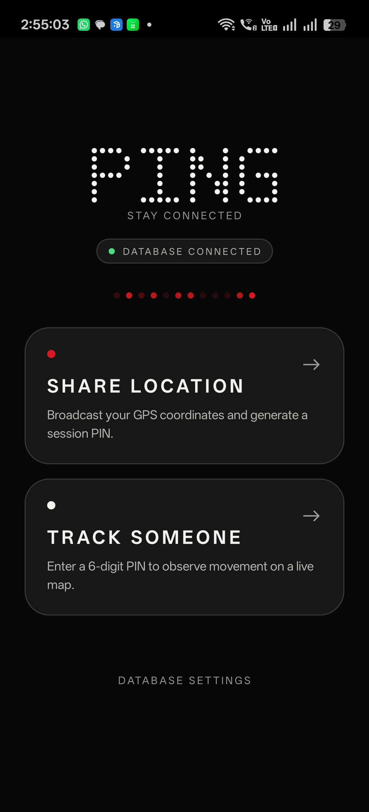
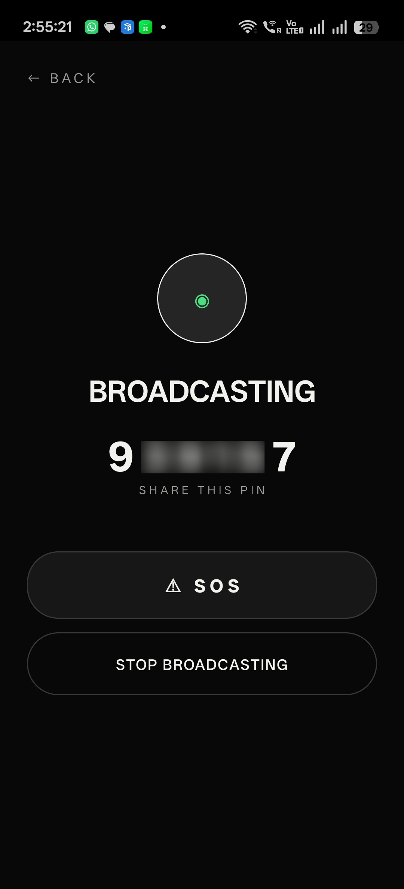
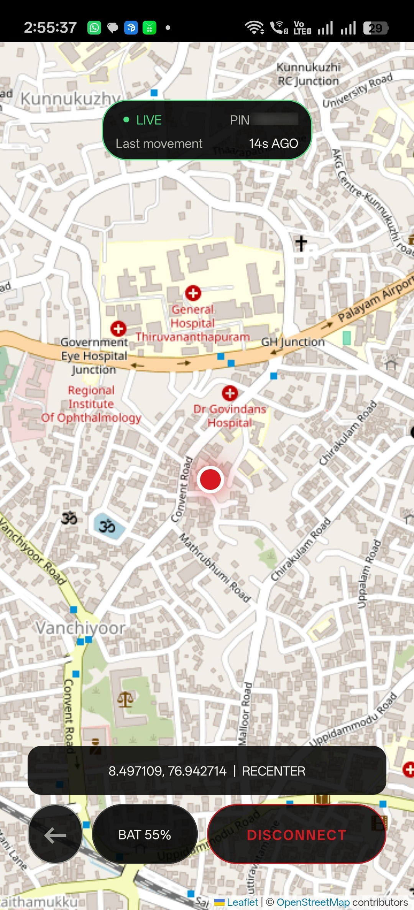

# PING

PING is a native Android location-sharing app built with Kotlin and Jetpack Compose. One phone broadcasts its location; one observer joins with a six-digit PIN and watches a Leaflet/OpenStreetMap map.

**Current source version: 1.1.4.** Firebase configuration is entered on each phone after installation. No user's Firebase project is built into the APK.

## Try the sample APK

Download [PING 1.1.4 sample APK](https://github.com/asishrj91/PING/releases/download/v1.1.4/PING-1.1.4-debug.apk) from [GitHub Releases](https://github.com/asishrj91/PING/releases/tag/v1.1.4).

This is a debug build for testing. Install it on both phones, then follow the [Firebase configuration guide](docs/FIREBASE_SETUP.md) and [phone setup guide](docs/USER_GUIDE.md). Both phones need configuration for the same Firebase project. No Firebase credentials are bundled in the APK.

## Screenshots

| Landing page | Broadcaster | Observer map |
| --- | --- | --- |
|  |  |  |

## Features

- First GPS fix is published immediately; subsequent coordinates are published after detected movement exceeds 5 metres from the last successfully published fix. GPS updates are requested approximately every 10 seconds, subject to Android scheduling and accuracy.
- A stationary broadcaster sends a heartbeat approximately every 30 seconds while connected. A location publication also acts as a heartbeat.
- The observer shows LIVE/stale heartbeat status, movement status, the broadcaster's battery percentage and charging state.
- Broadcaster SOS triggers a looping observer alarm with acknowledgement in the app or notification. Cancelling SOS or ending the broadcast stops it.
- Silent foreground notifications keep broadcasting and observer monitoring visible. Leaving the map or dismissing PING from Recents does not request that either service stop.
- Back preserves the observer session; Disconnect confirms and releases it. Stop Broadcast also requires confirmation.
- A compact dark interface, portrait orientation and saved session navigation.

## Start here

1. **Set up Firebase:** follow [Firebase setup](docs/FIREBASE_SETUP.md), including Anonymous Authentication and the supplied database rules.
2. **Build an APK:** follow [building, testing and GitHub publishing](docs/DEVELOPMENT.md), or use an APK from a trusted release of this repository.
3. **Install on both phones:** follow [installation and app usage](docs/USER_GUIDE.md).
4. **Test SOS while locked:** use the phone acceptance checklist before relying on background alerts.

See [local validation and remaining warnings](docs/VALIDATION.md) for the checks performed on this preparation.

Both phones must use the **same Firebase project and database URL**. Other people can use the same APK with their own Firebase project; they enter their own config in Database Setup.

## Firebase services and cost

PING uses **Firebase Realtime Database** and **Anonymous Authentication**. It does **not** use FCM, Cloud Functions, Cloud Storage, Analytics or a separately hosted backend. No Blaze upgrade or billing account is required by this implementation. Firebase Spark quotas and service limits still apply; exceeding them can interrupt the app. See [Firebase pricing](https://firebase.google.com/pricing) for current limits.

SOS delivery uses an ongoing observer database listener, not push messaging. The observer holds a partial wake lock while monitoring; both foreground services can increase battery use. Internet connectivity and phone power settings still determine delivery. PING is **not a guaranteed emergency alert service**.

## Quick build

Requirements: JDK **17**, Android SDK Platform **34**, Android SDK Build Tools **34.0.0**, and internet access for the initial dependency download. Supported phones run Android **8.0/API 26 or later**, with Google Play services and an up-to-date WebView.

Open **`PingNative/`** in Android Studio, set its Gradle JDK to 17, and install the SDK components through SDK Manager. No `google-services.json` is needed in the project.

From the repository root in PowerShell:

```powershell
Set-Location .\PingNative
.\gradlew.bat :app:testDebugUnitTest :app:lintDebug :app:assembleDebug
```

On macOS/Linux:

```sh
cd PingNative
sh ./gradlew :app:testDebugUnitTest :app:lintDebug :app:assembleDebug
```

APK output: `PingNative/app/build/outputs/apk/debug/app-debug.apk`.

## Repository layout

```text
PingNative/                 Android project and Gradle wrapper
  app/src/main/             Kotlin code, bundled map, resources and manifest
  app/src/test/             JVM tests
  check-map.cjs             Offline map logic regression test
  check-map-browser.cjs     Optional real-browser map test
firebase/                   Project-neutral database rules and emulator tests
docs/                       Firebase, installation, development and security guides
.github/workflows/ci.yml    Android and local database-rule checks
```

Generated APKs, build outputs, Gradle caches, `local.properties`, signing keys and personal Firebase config are ignored by Git. Put distributable APKs in **GitHub Releases**, not source history. The Gradle wrapper JAR and bundled Leaflet assets are intentional versioned dependencies.

## Security and limitations

The supplied rules enforce broadcaster ownership and a single observer claim. A PIN is a short bearer credential: before a session is claimed, any authenticated client that knows or guesses the PIN can read it and attempt to claim it. There is no account login, PIN-attempt rate limiter or App Check integration. See [security and data handling](docs/SECURITY.md) before exposing a project publicly.

Android Force stop, Active apps Stop, reboot, network loss and vendor battery management can interrupt monitoring. Open PING again after a reboot or Force stop. An SOS activated and cancelled entirely while the observer is offline cannot be recovered from the current-state database record.

## License and attribution

No license has yet been selected for PING's original code; publishing the repository does not itself grant an open-source license. The owner should choose a license before advertising it as open source. Bundled third-party license notices are retained in [THIRD_PARTY_NOTICES.md](THIRD_PARTY_NOTICES.md).
